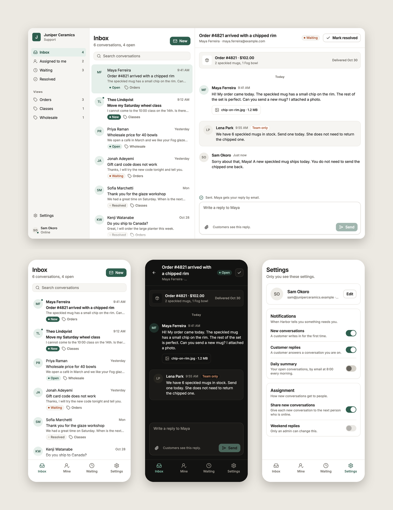

# mockz-sample

A sample design for [Mockz](https://design.mockz.app): **Harbor**, a shared
inbox for the support team of Juniper Ceramics, a small pottery shop. It
has four screens with eight states, three flows, a direction and nineteen
components, in light and dark, at phone, tablet and desktop size. The
team's notes, comments and statuses come with it. Everything is written
as Gesso TSX, which is code your developers can read.



## Open it

- **In your browser:** open
  [design.mockz.app/?repo=kevinpbaker/mockz-sample](https://design.mockz.app/?repo=kevinpbaker/mockz-sample).
  You do not need an account to look.
- **In the Mac app:** clone this repository, then choose
  File › Open Project… and select the folder.

  ```sh
  git clone https://github.com/kevinpbaker/mockz-sample.git
  ```

## Try this first

1. **Play the flows.** In the screens tree, open Inbox › Reply to a
   customer and press Play. Open any conversation: the next screen
   shows the one you pressed. Write a reply and press Send: the next
   screen shows what you wrote. The back arrow and the tab bar work
   too. Then play Start a conversation and type a name with no `@` in
   To: Send takes you back with an error. Correct it, and Send goes on.
2. **Open the menus.** In Play, press Sam Okoro to assign the
   conversation, or Mark resolved to see the dialog. On the board, the
   `assigning` and `resolving` states show them open.
3. **Take the tour.** The Inbox's `tour` state is what a new teammate
   sees first. `tour-places` is its second step.
4. **Read the team's work.** Statuses color the sections of the board.
   Notes are on the Conversation screen, and a comment thread is on the
   Inbox at desktop size.
5. **Compare a direction.** `compact` under the Inbox is a one-line list
   to keep or drop.
6. **Look at the Components page.** Each component shows each of its
   states, and Mockz adds hover, pressed and focused.
7. **Change the brand.** In `theme.ts`, change `primary` from `#2E5E4E`
   to a color you like, and switch to dark. All screens and components
   change.

## What is in it

| Where | What |
| --- | --- |
| `theme.ts` | The design system: colors (light and dark), the type scale in Inter, radii, shadows, control sizes for a mouse and a finger, and the timing of motion. |
| `fonts/` | Inter, in four weights. |
| `components/` | The parts the screens are made of. Each `.examples.tsx` file gives a component's states for the Components page. |
| `mocks/Inbox/` | The inbox (empty, and on tour), a conversation (assigning, resolving, after a reply), a new conversation (with an error, and sent), and the two flows that connect them (`flows.ts`). |
| `mocks/Settings.tsx` | Your profile, notifications and assignment settings. |
| `variations/Inbox/` | A direction for the inbox, `compact`. |
| `.mockz/` | The team's statuses, notes and comments. Mockz keeps them in the repository, so they travel with the design. |
| `code-links.json` | Where four of the components are built in the team's code, for Develop mode. |
| `assets/icons/` | Icons from [Lucide](https://lucide.dev). |

### Components

| Component | What it is for |
| --- | --- |
| `AppShell` | The sidebar from a tablet up, and the tab bar on a phone. |
| `AssignMenu` | Who a conversation is assigned to, and a popover to change it. |
| `Avatar` | A person's initials in a circle. |
| `Button` | Primary, secondary and quiet buttons, with an icon or without. |
| `Card` | A group of related rows, with a title. |
| `ConversationRow` | One conversation in the inbox: unread, read or selected. |
| `EmptyState` | What a list shows when it has nothing in it. |
| `Icon` | One of the project's icons, in the color of the text around it. |
| `InboxList` | The inbox's header, search and conversations. |
| `Message` | One message in a conversation, or a note only the team sees. |
| `NavItem` | A place in the app, in the sidebar or in the tab bar. |
| `PageHeader` | The title of a screen, with room for a back button and actions. |
| `ReplyBox` | Where the team writes a reply. |
| `ResolveButton` | Mark resolved, and the dialog that makes sure. |
| `SearchField` | A field to find a conversation. |
| `SettingsRow` | One setting and its control. |
| `StatusPill` | New, open, waiting or resolved. |
| `TextField` | A labeled field, with an error. |
| `Toggle` | An on and off switch. |

## How it is written

Use this sample as a model for your own design:

- **Tokens by name, not values.** Write `backgroundColor="surface"`,
  `textStyle="title"` and `borderRadius="medium"`. Mockz's checker finds
  values that are not in the theme.
- **Controls that work in Play.** Buttons, rows, toggles and fields have a
  role, take focus, and answer the pointer and the keyboard. Their values
  go through `controlled`, so a screen can write `<Toggle on={true} />`
  and Play can turn it.
- **Sizes that follow touch.** Phone and tablet frames are touch frames.
  Controls get their height from `controlSizes` in `theme.ts`, so they
  are at least 44 pixels high there.
- **Motion by name.** Hover and press ease with `transition={{ opacity:
  'press' }}`. `theme.ts` sets how long `press` is.
- **States are inputs.** A selected row is `<ConversationRow selected={true} />`.
  A screen does not draw a state by hand.
- **Moments are not copies.** A state that is only a moment of a screen,
  such as a menu open or a tour's second step, starts the screen from the
  inputs that make it, with `StartingInputs`.
- **Overlays are Gesso's.** The popover, the dialog and the tour use
  Gesso's `Popover`, `Dialog` and `Tour`. Mockz draws them in their frame,
  on the board and in Play.
- **Values a flow carries.** The reply and the To address are shared
  values (`sharedValue`), so a later screen shows what was typed, and a
  flow can branch on it (`when: { value: 'to', is: 'not an email' }`).
- **Flows that read like the product.** A step taken by any row names
  the component (`press: 'ConversationRow'`), and the row's inputs are
  values the conversation shows. A step can start its screen from
  inputs (the Resolve dialog open) instead of a state file of its own.

All the people, the shop and the text in this design are made up.
Inter is under the [SIL Open Font License](fonts/Inter/OFL.txt), and
Lucide's icons are under the ISC License.
